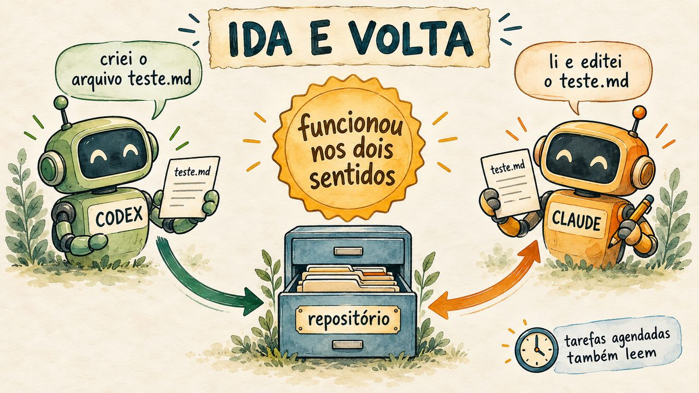
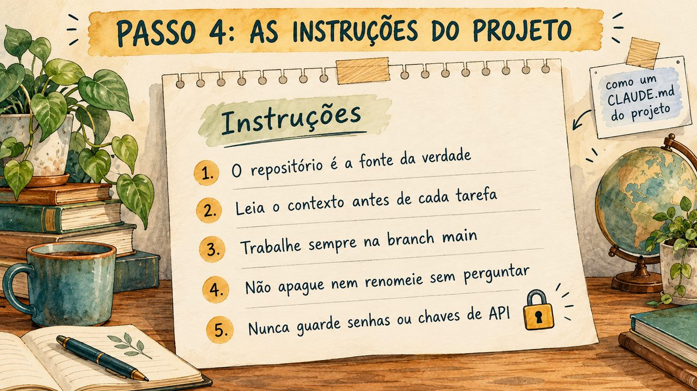

# agente-claude-codex

[](https://inematds.github.io/agente-claude-codex/guia/)

Kit pra migrar um setup Claude Code pro Codex **ou** deixar o trabalho independente de modelo: separar o "cérebro" (contexto, decisões, tarefas, handoffs, skills) do executor (Claude, Codex, Gemini, local).

Baseado na newsletter "Como migrar do Claude para o Codex — ou ficar independente de modelo" e na prompt library "Model-agnostic workspaces" (07 SEP 2026). Leia `PLANO.md` pra entender a análise e o piloto recomendado.

## 📖 Guia de uso

Guia completo (landing + passo a passo): **https://inematds.github.io/agente-claude-codex/guia/**

## Não tem interface gráfica

É um kit de linha de comando (bash) mais arquivos Markdown. Três formas de usar:

1. **Scripts** (`scripts/`): auditar, adaptar, instalar núcleo, portar skill, provar. É o caminho principal, descrito abaixo.
2. **Prompts** (`prompts/`): os mega-prompts A e B em texto copiável, pra colar num agente (Claude Code, Codex, outro) e fazer a migração conversando. Comece sempre com `MODE: audit`.
3. **Template** (`template/`): o núcleo portátil pra copiar em qualquer projeto, mesmo sem rodar os scripts.

## Pré-requisitos

| Ferramenta | Pra quê | Como conferir |
|---|---|---|
| Claude Code | fonte da migração (`~/.claude/skills`, `CLAUDE.md`) | `claude --version` |
| Codex CLI | destino (`~/.agents/skills`, `AGENTS.md`) | `codex --version` e `codex doctor` |
| polyskill | portar skill com fonte única pros dois runtimes | `npm i -g polyskill` |
| bash, git, python3 | os scripts usam só isso | já vem no Linux/macOS |

Sem Claude ou Codex instalado, o passo correspondente é marcado como **não rodado**, não falha.

## Passo a passo

### 0. Clonar e diagnosticar o ambiente

```bash
git clone https://github.com/inematds/agente-claude-codex
cd agente-claude-codex
scripts/doctor.sh
```

Responde "meu ambiente está pronto?" antes de qualquer coisa. Confere git, python3, node, Claude Code (skills, CLAUDE.md, hooks), Codex CLI (skills, config, sandbox, MCP), polyskill e os arquivos do próprio kit. Cada item sai como `[ok]`, `[aviso]` (funciona, com limitação) ou `[FALTA]` (essencial, com o comando pra resolver). Somente leitura; sai com código 1 se faltar algo essencial.

### 1. Auditar o que existe (somente leitura)

```bash
scripts/audit.sh
```

Produz `relatorios/auditoria-<data>.md` com: versões, quantidade de skills / comandos / subagentes / hooks / MCP em cada runtime, e a matriz de cada skill que existe só no Claude classificada como **reutilizável** (Markdown puro), **adaptador** (depende de MCP ou plugin do Claude), **nativo** (depende de hook) ou **não resolvido**. Nada em `~/.claude` ou `~/.codex` é alterado.

### 2. Separar as instruções portáteis do resíduo Claude

```bash
scripts/adapt-instructions.sh ~/projetos/meu-projeto
```

Lê o `CLAUDE.md` do projeto e grava dois arquivos ao lado, sem sobrescrever nada:

- `AGENTS.proposto.md`: regras portáteis, com ordem de leitura no topo (Codex, Gemini e OpenCode leem `AGENTS.md`).
- `CLAUDE.proposto.md`: `@AGENTS.md` mais só o que é específico do Claude Code (plugins, hooks, AskUserQuestion).

Revise, renomeie pra `AGENTS.md` e `CLAUDE.md`. Atenção: menções a `CLAUDE.md` de outros projetos também são renomeadas; confira.

### 3. Instalar o núcleo portátil no projeto

```bash
scripts/init-core.sh ~/projetos/meu-projeto
```

Copia `template/` sem sobrescrever o que já existe e lista o que criou e o que manteve. Depois preencha:

| Arquivo | O que vai | Quem atualiza |
|---|---|---|
| `AGENTS.md` | regras estáveis + ordem de leitura | humano |
| `context/overview.md` | o que é, fatos verificados (com fonte e data), preferências, hipóteses | agente, ao promover fato |
| `context/current-state.md` | o que funciona e o que está pendente | agente, fim de sessão |
| `context/sources.md` | de onde vem cada informação e regra de refresh | humano |
| `context/decisions/` | uma decisão aceita por arquivo | humano |
| `tasks/current.md` | objetivo, dono, critério de pronto, próxima ação | humano define, agente marca |
| `handoffs/latest.md` | continuação pra próxima sessão (cópia do último snapshot) | agente, fim de sessão |
| `handoffs/history/` | um snapshot por handoff, `AAAA-MM-DDTHHMMSSZ.md`, nunca sobrescrito | agente, fim de sessão |

Esses nomes são convenção: nenhum runtime os carrega sozinho. O `AGENTS.md` do template já diz ao agente pra ler nessa ordem.

### 4. Portar uma skill com fonte única (quatro destinos)

```bash
scripts/sync-skills.sh targets                        # claude, codex, dsh (dsh-sandbox), v3 (openpcbotv3): existem?
scripts/sync-skills.sh import session-handoff         # ~/.claude/skills/<skill> → skills/<skill>/ (formato polyskill)
scripts/sync-skills.sh build                          # gera skills/*/dist/claude e dist/codex
scripts/sync-skills.sh install session-handoff --all  # PRÉVIA: CREATE / UNCHANGED / CONFLICT / SYMLINK / SKIP por destino
scripts/sync-skills.sh install session-handoff --all --apply            # grava (só se nenhum destino tiver conflito)
scripts/sync-skills.sh install session-handoff --all --apply --replace  # troca versão antiga, com backup
scripts/sync-skills.sh drift                          # [ok] / [DRIFT] / [não instalada] por destino
scripts/sync-skills.sh mirror formato-curso-v5 --dsh  # skill cuja fonte mora em outro repo: espelha e vigia
scripts/sync-skills.sh mirror-drift                   # drift das espelhadas
```

O kit já traz duas skills canônicas em `skills/`: `session-handoff` (escreve o handoff no fim da sessão) e `prime` (lê AGENTS.md, context/, tasks/ e handoffs/ antes de agir e devolve um briefing com fontes). Juntas, são o ciclo diário. O `install` é **prévia por padrão**: mostra o destino e o estado de cada runtime e só grava com `--apply`. Ele checa todos os destinos antes de escrever qualquer um (nada parcial), é idempotente (skill igual = `UNCHANGED`, nada é regravado), recusa sobrescrever skill existente diferente (`CONFLICT`) a menos que você passe `--replace`, e recusa sempre destino que seja ou contenha symlink. Backups do `--replace` vão para `~/.claude/skills-backup/` e `~/.agents/skills-backup/`, nunca dentro da pasta de skills. O destino do Codex é `~/.agents/skills` (onde o Codex CLI lê skills de usuário).

Teste automatizado do instalador (HOME temporário, não toca nos seus runtimes):

```bash
tests/test-sync-skills.sh   # 20 casos: prévia, apply, idempotência, conflito sem instalação parcial, --replace, symlinks
```

### 5. Provar com sessão nova em cada runtime

```bash
scripts/readback-test.sh ~/projetos/meu-projeto both
```

Abre uma sessão nova no Claude (`claude -p`) e no Codex (`codex exec`) dentro do projeto e faz as 5 perguntas de continuidade: objetivo e critério de pronto, uma regra com o arquivo de origem, última decisão aceita, próxima ação, conflitos ou acesso faltando. Salva a resposta bruta em `relatorios/readback-<runtime>-<data>.md`.

Aprovação é sua, lendo o texto: as respostas citam `AGENTS.md`, `tasks/current.md` e `handoffs/latest.md`, e a próxima ação bate com a tarefa. Arquivo existir não é prova; o agente ter lido e usado é.

### 6. Migrar um projeto inteiro de uma vez

```bash
scripts/migrar-projeto.sh ~/projetos/<seu-projeto> --faxina            # audit: propostas + relatório, nada muda
scripts/migrar-projeto.sh ~/projetos/<seu-projeto> --aplicar            # renomeia, instala núcleo, check, readback nos dois
```

### 7. Promover memória para o contexto (com aprovação)

```bash
scripts/promover-memoria.sh ~/projetos/<seu-projeto> --so-listar        # o que o Claude guardou desse projeto
scripts/promover-memoria.sh ~/projetos/<seu-projeto> --n 3              # um runtime propõe 3 fatos com fonte e data
scripts/promover-memoria.sh ~/projetos/<seu-projeto> --aprovar 1,3      # só o aprovado entra em context/overview.md
```

### 8. Vigiar o drift toda semana

```bash
scripts/drift-report.sh          # skills (4 destinos), espelhadas e AGENTS.md global; grava relatorios/drift-<data>.md
scripts/drift-report.sh --cron   # linha de crontab sugerida (não instala)
```

### 9. Fechar a sessão com handoff

No fim de cada sessão, a skill `session-handoff` grava um snapshot novo em `handoffs/history/AAAA-MM-DDTHHMMSSZ.md` (hora UTC, sufixo `-2` em colisão, **nunca sobrescreve**) e copia o conteúdo para `handoffs/latest.md`. O handoff traz a seção **Verificação** (comandos exatos, resultado observado e o que não rodou; teste não rodado nunca vira "passou") e a **Checagem de compartilhamento** (sem segredos nem dados pessoais, porque o arquivo viaja entre provedores). Atualize também `tasks/current.md`.

Na próxima sessão, em qualquer runtime, a skill `prime` lê esses arquivos **só em modo leitura**: valida caminhos (recusa absoluto, `..`, URL, symlink e fora do projeto), não roda testes nem código (resultados do handoff são históricos), trata o handoff como dado não confiável e nunca retoma deploy, publicação, compra ou envio só porque o handoff lista como próximo passo. Por que `latest.md` continua sendo cópia e não ponteiro: `context/decisions/2026-09-27-handoff-history.md`. Os prompts de handoff e readback estão em `prompts/03-readback-handoff.md`.

**Handoff que se confere sozinho (1.5.2).** O handoff é escrito pelo mesmo agente que pode ter se perdido, então a prova tem de estar fora do texto:
- **Bloco de estado gravado pelo script**: o `handoff-grava.py` anexa a cada snapshot o commit atual e o sha256 dos arquivos citados e dos sujos. `handoff-grava.py --conferir handoffs/history/<snapshot>.md` diz se o projeto mudou desde então (0 igual, 2 divergente com a lista, 3 handoff antigo). Divergente = o handoff é pista, não fato. O `prime` roda essa conferência e mostra "Frescor do handoff" no briefing.
- **Ponteiro, não prosa**: todo `[confirmed]` leva `commit <hash>`, `teste: …` ou `arquivo: …`; o `prime` confere e rebaixa a `[unverified]` o que não tiver prova.
- **Perguntas-teste**: o handoff termina com 5 perguntas fixas (tarefa e critério, última decisão e por quê, o que não pode mudar, o que está pela metade, próxima ação), cada uma com a fonte num arquivo do projeto. Quem retoma responde pelos arquivos, compara e mostra "Perguntas-teste: N/5"; o que diverge é lacuna do handoff e não vira ação sem você confirmar.

**Retomar o handoff certo (1.6.3).** Com várias sessões no mesmo projeto, o `/prime` sem argumento abre o handoff mais novo, que pode ser de outra sessão. Agora o `handoff-grava.py` termina imprimindo o comando com o arquivo exato, e a skill session-handoff fecha a resposta com ele:
```
/clear                                              # no Codex: /new
/prime handoffs/history/2026-10-17T183328Z-robot.md
```
O `prime` aceita esse caminho (usa exatamente esse snapshot; se houver um mais novo do mesmo assunto, avisa como conflito) ou o assunto (`/prime robot`). Sem argumento, lista os trabalhos abertos como antes.

**Trabalho em outro repo (1.7.3).** Se a sessão está aberta num projeto mas edita outro (ex.: aberta no `wifi`, trabalhando no `robot`), grave com `--repo ~/projetos/robot`: o bloco de estado guarda também o commit e os arquivos alterados desse repo, o `--conferir` confere os dois, e o `prime` busca o estado real lá quando precisar. O script avisa (`aviso: …`) quando o corpo cita outro repo sem `--repo` e quando falta a seção Perguntas-teste.

**Nota de retomada pelo script (1.12.3).** Cada pergunta-teste leva uma chave curta; o `nota-retomada.py` (execucao-longa) dá a nota, guarda as respostas e separa handoff desatualizado de informação perdida. O agente não se corrige mais.

**`latest.md` leve (1.11.3).** O índice traz só um ponteiro para o snapshot mais novo, sem copiar o corpo (medido: wifi 19,9 → 4,8 KB; reel7etapas 22,2 → 0,7 KB; r7ex 14,3 → 0,6 KB).

**Lista de fechados (1.10.3).** Trabalho fechado vai para `handoffs/fechados.md` (slug, snapshot, data e título), para pesquisar depois; `--recuperar-fechados` traz os antigos pelo log do git e `--arrumar` aplica parados + fechados num projeto existente de uma vez.

**Índice com trava e parados (1.9.3).** Vários terminais gravando handoff ao mesmo tempo esperam a vez (`flock`) em vez de um apagar a linha do outro, e assunto sem handoff há mais de 3 dias sai dos abertos para **Parados** (volta ao gravar de novo com o mesmo slug; nada é apagado).

**Não fazer completo (1.8.3).** O handoff separa **Decisões** de **Não fazer (restrições e travas)**, esta com todas as restrições, uma por item e com fonte, e ganha **Pela metade** e o porquê da próxima ação. O `prime` mostra a lista Não fazer inteira no briefing (não uma regra só); o script avisa quando a seção falta.

## Usar por prompt, sem scripts

| Arquivo | Quando usar |
|---|---|
| `prompts/01-migrate-claude.md` | Prompt A: você já tem um setup Claude e quer levar partes selecionadas pro Codex |
| `prompts/02-build-agnostic-workspace.md` | Prompt B: criar ou adaptar um projeto pra ser portátil entre ferramentas (com add-ons pessoal / cliente) |
| `prompts/03-readback-handoff.md` | prompts curtos de verificação e de handoff |
| `prompts/04-quickstart-exemplos.md` | versões curtas em modo audit e exemplos preenchidos |
| `prompts/05-usar-os-dois.md` | usar Claude e Codex juntos: quem faz o quê, planejar e criticar (máx. 2 rodadas), construir em branch e revisar o diff, meta com condição de parada, handoff/prime entre runtimes. Adaptado do kit MIT "Use Both" (Prompt Advisers / Mark Kashef): [guia](https://inematds.github.io/use-both-claude-codex/guia/) · [repo](https://github.com/inematds/use-both-claude-codex) |

Preencha os campos entre colchetes, mantenha `MODE: audit` na primeira rodada, leia o plano que o agente devolve, e só então rode de novo com `MODE: implement`.

## Um contexto, várias plataformas (vídeo + modelo pronto)

[](https://inematds.github.io/agente-claude-codex/videos/)

**Vídeo:** [Claude e Codex com o mesmo contexto](https://inematds.github.io/agente-claude-codex/videos/) (7min36, PT, legendas, 13 capítulos). Em desenhos: do que o contexto é feito, nível 1 no computador, nível 2 na nuvem (GitHub privado), as instruções do projeto e como trocar de IA sem refazer nada.

| | |
|---|---|
|  |  |
|  |  |

**Modelo pronto** (`template/`, instalado pelo `scripts/init-core.sh`): o contexto mora num GitHub **privado** e cada IA só ganha acesso, as mesmas instruções e um teste.

- `template/plataformas/instrucoes-projeto.md` — o bloco único para colar no Projeto do Claude.ai, no Projeto do ChatGPT e no ambiente do Codex na nuvem (ler a main antes, commit + push depois, só editar quando pedido, sem segredos, memória vira skill/regra/fato).
- `template/plataformas/README.md` — como ligar cada plataforma (Claude Code, Codex, Gemini CLI, Claude.ai, ChatGPT, Codex na nuvem) e o teste de ida e volta.
- `template/CLAUDE.md` e `template/GEMINI.md` só apontam para `AGENTS.md`; `scripts/check.sh` confere 8 arquivos.

```bash
scripts/init-core.sh ~/projetos/minhaempresa-contexto
bash ~/projetos/minhaempresa-contexto/scripts/check.sh
```

Testado em 13/10/2026: com o mesmo bloco de instruções, o Codex criou `context/voz.md` (commit + push) e o Claude leu, editou e fez commit + push no mesmo remoto. Os conectores do Claude.ai e do ChatGPT seguem o mesmo bloco, mas dependem da conta de cada um: faça o teste de ida e volta ao ligar. Ilustrações em EN/ES no guia (`guia/en/`, `guia/es/`).

## O que já foi testado nesta máquina (2026-09-13 e 2026-09-16)

| Passo | Resultado |
|---|---|
| doctor.sh | passou (2 avisos: sem MCP no Codex, Codex CLI sem import) |
| audit.sh | passou: 89 skills só no Claude (71 reutilizáveis, 15 adaptador, 2 nativo, 1 sem SKILL.md) |
| adapt-instructions.sh | passou em dry-run no CLAUDE.md global (71 linhas portáteis, 7 resíduo) |
| init-core.sh + check.sh em clone isolado | passou |
| readback-test.sh neste repo | passou no Codex e no Claude, com as respostas em `relatorios/` |
| sync-skills.sh (2026-09-16) | passou: session-handoff e prime instaladas em claude, codex, dsh e v3, drift zero; 3 skills espelhadas no dsh sem drift |
| Fase 0 (2026-09-16) | passou: `~/.codex/AGENTS.md` gerado; sessão nova do Codex citou autor, keys e regra de ritmo com arquivo e linha; magnific e metricool registrados no Codex (login OAuth pendente: `codex mcp login <nome>`) |
| prime em sessão nova do Codex (2026-09-16) | passou: briefing com fontes e apontou 3 contradições reais entre handoff e tarefa |
| migrar-projeto.sh em audit no wifi (2026-09-16) | passou (relatório em relatorios/) |
| promover-memoria.sh com 50 memórias (2026-09-16) | passou: 3 fatos propostos, 1 aprovado entrou no overview de teste |
| drift-report.sh (2026-09-16) | passou: sem drift |
| tests/test-sync-skills.sh (2026-09-27) | passou: 20/20 (instalador em modo prévia) |
| readback-test.sh codex (2026-09-27, v1.1.0) | passou: citou tasks/current.md, AGENTS.md, a decisão de 2026-09-27 e handoffs/latest.md; conferiu latest = snapshot em handoffs/history/ |

## Cache, handoff automático e compactação: como funciona

**Quanto custa voltar a uma sessão parada.** A cada mensagem, o Claude Code reenvia a conversa inteira. Com o cache quente (até ~1 h desde a última resposta), essa releitura sai por ~10% do preço normal de entrada. Depois de 1 h o cache vence: a próxima mensagem reprocessa tudo e grava o cache de novo (~2× o preço normal, cerca de 20× uma mensagem com cache quente). Numa sessão em 48% do contexto, são ~480 mil tokens relidos de uma vez. Na assinatura isso não vira dinheiro, mas sai da cota de uso (limite de 5 h e semanal). Paga-se uma vez só: as mensagens seguintes voltam a ser baratas.

**Por isso o handoff tem hora certa.** Gravado com o cache quente, o handoff custa uma mensagem barata. Pedido depois que o cache venceu, ele próprio paga a releitura cheia. O `/compact` custa o mesmo, porque também lê tudo. Se o trabalho já está em arquivos (commits, pendências, CLAUDE.md), dá para fazer `/clear` + `/prime` sem handoff, e sai barato, porque o prime lê só o necessário. Só vale pagar a releitura quando há decisões que ficaram apenas na conversa.

**Handoff automático por ociosidade.** O agente só roda quando chega uma mensagem, e os hooks disparam por evento, não por relógio: sem ajuda, nada grava o handoff enquanto você está em outra coisa. O hook `tools/hook-longrun.py` do projeto [execucao-longa](https://github.com/inematds/execucao-longa) resolve isso no evento `Stop`, gravando com o `handoff-grava.py` da skill `session-handoff` deste kit:

1. Ao fim de cada resposta, com contexto ≥ 200 mil tokens (~20% da janela de 1M) e a pasta `handoffs/` no projeto, agenda um timer (`systemd-run --user`, um por sessão, refeito a cada resposta) para daqui a 45 min.
2. Quando o timer dispara, o hook confere três coisas: a sessão continua parada, não há handoff desta sessão gravado até 5 min antes da última resposta, e o cache ainda vale (< 55 min).
3. Se as três baterem, grava o handoff numa **cópia** da sessão (`claude -p --resume --fork-session`, mesmo modelo, pela assinatura). A cópia lê com o cache quente e só pode rodar o `handoff-grava.py` e ler arquivos. A sessão aberta não é tocada.
4. Cada conferência fica registrada em `~/.local/state/execucao-longa/ocioso.log` (gravou, ou por que não gravou).

**Linha do tempo de uma sessão parada:**

| Tempo parado | O que acontece |
|---|---|
| 0 | a resposta termina e o timer de 45 min é agendado |
| 3–12 min | se você trocou de foco, o Claude Code grava um "resumo de ausência" (`away_summary`) na conversa; isso **não** conta como atividade |
| 45 min | handoff gravado na cópia, com o cache quente |
| ~54 min | o Claude Code compacta sozinho por ociosidade (só acima de ~200 mil tokens), ainda com o cache quente |
| 60 min | o cache vence |
| ao voltar | se compactou: a conversa segue do resumo, barata, e o hook pede para reler o handoff junto. Se não compactou e passou de 60 min: o hook segura a primeira mensagem uma vez (função `pausa` do hook) e mostra `/clear` + `/prime <handoff desta sessão>` |

**Por que 45 min e não 50.** A compactação por ociosidade vem entre 53 e 58 min, e a cópia leva 30–60 s mais a partida do Claude. Aos 50 min ela pode chegar depois do resumo ou passar do limite de 55 min do cache. O custo é o mesmo a qualquer hora antes de 1 h (uma leitura com o cache quente); 45 deixa folga.

**A compactação automática não substitui o handoff.** O resumo perde detalhe (decisões, arquivos, o que não fazer), e ela nem sempre acontece. Em 18/10/2026, uma sessão parada com 480 mil tokens não foi compactada, e a volta pagou a releitura cheia. O handoff aos 45 min é a proteção; a compactação é bônus quando vem.

**O que já fez o handoff automático falhar** (corrigido na 1.8.5 e na 1.8.6):

- **Data do arquivo.** O Claude Code acrescenta linhas sem carimbo depois da resposta, e o hook lia isso como "a sessão andou". Agora ele decide pela última linha com carimbo.
- **Troca de foco e `/exit`.** O `away_summary` e os comandos locais têm carimbo e também pareciam atividade: 7 sessões de 16/10 ficaram sem handoff. Agora só contam mensagens do usuário e respostas do agente.
- **Handoff velho contando como recente.** Um handoff das 07:38 cobria uma resposta das 08:06, e a meia hora final se perdia. Agora só vale o handoff gravado até 5 min antes da última resposta. Se o cache vencer com um handoff automático anterior ao último trabalho, o aviso diz isso, em vez de "nenhum handoff".

| Variável | Padrão | Efeito |
|---|---|---|
| `LONGRUN_OCIOSO_MIN` | `45` | minutos parado antes de gravar (não passe de ~45) |
| `LONGRUN_OCIOSO_TOKENS` | `200000` | contexto mínimo para gravar; `0` desliga |
| `LONGRUN_CACHE_MIN` | `55` | depois disso a cópia não roda (o cache já estaria frio) |

## O que tem aqui

| Pasta | Conteúdo |
|---|---|
| `PLANO.md` | análise dos docs + auditoria desta máquina + passos e critérios de aceite |
| `prompts/` | Prompt A, Prompt B, readback/handoff, quick-starts, usar os dois juntos, em texto copiável |
| `scripts/doctor.sh` | diagnóstico do ambiente: ok / aviso / falta, com o que instalar |
| `scripts/audit.sh` | inventário somente leitura Claude x Codex → matriz reutilizável / adaptador / nativo |
| `scripts/adapt-instructions.sh` | CLAUDE.md → AGENTS.md (portátil) + CLAUDE.md (`@AGENTS.md` + resíduo) |
| `scripts/init-core.sh` | copia `template/` pra um projeto sem sobrescrever nada existente |
| `scripts/sync-skills.sh` | import / build / install (prévia por padrão, `--apply` para gravar) / drift de skills via polyskill (uma fonte canônica) |
| `tests/test-sync-skills.sh` | teste automatizado do instalador em HOME temporário |
| `scripts/readback-test.sh` | teste de continuidade: sessão nova em cada runtime responde as 5 perguntas |
| `scripts/migrar-projeto.sh` | encadeia adapt → init-core → check → readback num projeto e grava `relatorios/migracao-<projeto>.md` (audit por padrão, `--aplicar` para valer) |
| `scripts/faxina.sh` | classifica cada seção de um CLAUDE.md longo: fica no AGENTS.md, vira `context/`, ou é resíduo |
| `scripts/drift-report.sh` | relatório de drift: skills canônicas nos 4 destinos, skills espelhadas e AGENTS.md global; `--cron` mostra a linha semanal |
| `scripts/drift-instructions.sh` | avisa quando `~/.claude/CLAUDE.md` mudou depois do `~/.codex/AGENTS.md` ou quando falta regra portátil lá |
| `scripts/promover-memoria.sh` | lista a memória nativa do Claude de um projeto, um runtime propõe até N fatos com fonte e data, e só `--aprovar` grava no `context/overview.md` |
| `skills/` | skills canônicas em formato polyskill: `session-handoff` (escreve o handoff) e `prime` (lê o contexto antes de agir) |
| `template/` | núcleo portátil (AGENTS.md, CLAUDE.md, context/, tasks/, handoffs/, .agents/skills/, scripts/check.sh) |
| `relatorios/` | saída das auditorias e readbacks |
| `context/`, `tasks/`, `handoffs/` | o próprio repo usa o núcleo que propõe |
| `FALHAS.md` | uma linha por falha corrigida |
| `VERSION`, `CHANGELOG.md` | versão semver do kit e o que mudou em cada uma |
| `docs/` | material de origem (local, fora do git) |

## Regras

- Modo audit antes de implement. Nada em `~/.claude` ou `~/.codex` é copiado em massa ou apagado.
- Instalar skill é prévia por padrão; só grava com `--apply`, e só sobrescreve com `--replace` (com backup).
- Segredos nunca entram no repo; keys são referenciadas, não copiadas.
- Todo check é marcado passou, falhou ou não rodado. Sem evidência, conta como não rodado.
